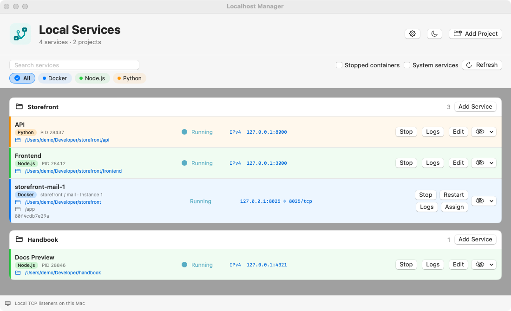

#  Localhost Manager

Localhost Manager is a native macOS app for discovering and managing local development services. See what's using a port, open a service in your browser, or jump to its working directory in Finder.



## Install

Localhost Manager requires macOS 14 Sonoma or later and runs on Apple Silicon and Intel Macs.

1. Download the macOS ZIP from the [latest GitHub release](https://github.com/rupertgermann/localhost-manager/releases/latest).
2. Unzip the archive and move **Localhost Manager.app** to **Applications**.
3. Open **Localhost Manager**. The app uses an ad hoc signature and macOS may block the first launch. Verify the ZIP with the SHA-256 file on the release page before approving the app in **System Settings → Privacy & Security → Open Anyway**. See [Apple’s instructions for opening an app](https://support.apple.com/en-us/102445).

## Use the app

- Click a category above the list to filter services such as Docker, Node.js, or Python. **All** clears the category filter. You can also search by name, port, or working directory.
- Open the eye menu on a row to hide services with the same name or host port. Open **Settings** to see matching services and remove a rule. Rules only affect what the app displays.
- Choose **Add Project** and select a folder to group services by directory. Use **Edit** to assign a native service or **Assign** to assign a container.
- Click an address to open it in your browser. The app uses HTTP by default and HTTPS for port 443. Save a full web address on the service to use a different scheme or path.
- Click a local working directory to open it in Finder. Docker working directories can open in Finder when a bind mount maps them to a local folder.
- Add a working directory and **Start command** in **Edit** to let the app start and restart a native service. Jobs run under your macOS account and keep running when you quit the app. **Logs** shows captured output for managed jobs or a log file you specify for an external process.
- Run Docker locally to see containers, published ports, and logs. You can start, stop, or restart containers independently. The app connects to a local Docker daemon via a Unix socket.
- Click the sun or moon next to **Add Project** to change the appearance. The app remembers your choice.

## Build from source

Install Xcode or the Xcode Command Line Tools. From the repository root, run:

```sh
swift test
./build-app.sh
open "build/Localhost Manager.app"
```

See the [release guide](docs/releasing.md) to build and verify the GitHub release archive.

## Privacy

The app keeps its service catalog and managed logs on your Mac under `~/Library/Application Support/Lokalhost Manager/`. It does not send telemetry. Docker inventory and actions use a local Unix socket. The app opens browser or Finder destinations when you choose them.

Saved commands and service logs can contain credentials or other private data. Review them before sharing.

## Support

Support development on [Patreon](https://patreon.com/rupertgermann) or [Buy Me a Coffee](https://buymeacoffee.com/rupertgermann).

## License

[MIT](LICENSE)
